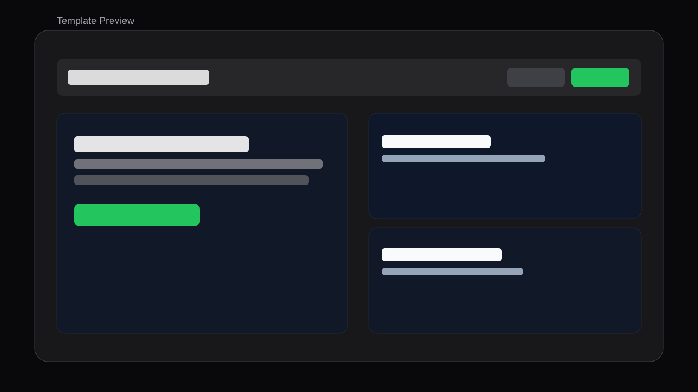

# React + TypeScript + Shadcn UI Production Template

[](./LICENSE)
[](https://github.com/ghostshreyash/vite-react-shadcn-template/commits/main)
[](https://github.com/ghostshreyash/vite-react-shadcn-template/stargazers)

A production-oriented Vite starter with React 19, TypeScript, Shadcn UI, React Query, React Router v7, auth boilerplate, dark mode, and CI/pre-commit quality checks.

## Live Demo

- Vercel: [https://vite-react-shadcn-template.vercel.app](https://vite-react-shadcn-template.vercel.app)

## Preview



## Why this template?

Compared with a plain starter like `create-react-app` or a default Vite scaffold, this template includes common production wiring out of the box:

- Routing with `react-router-dom` v7 and guarded routes
- Auth scaffolding (login/register pages, token persistence, Axios auth header injection)
- Global runtime safety with an application error boundary and custom 404 page
- Built-in dark mode toggle via `next-themes`
- State management baseline with `zustand`
- i18n skeleton with `react-i18next`
- CI and pre-commit quality gates (ESLint + TypeScript + Prettier)

## Features

- Vite + React 19 + TypeScript strict mode
- Shadcn UI components with Tailwind CSS v4
- TanStack Query setup (`QueryClientProvider`)
- React Router v7 app structure
- Auth boilerplate with protected routes
- Global Error Boundary and 404 page
- Theme toggle (light/dark/system)
- Zustand store example (`auth-store`)
- i18n skeleton (`en` + `hi`) via `react-i18next`
- GitHub Actions CI (`lint` + `type-check`)
- Husky + lint-staged + Prettier pre-commit formatting/linting

## Getting Started

### Prerequisites

- Node.js 18+
- npm 9+

### Setup

1. Clone the repo:

```bash
git clone https://github.com/ghostshreyash/vite-react-shadcn-template.git
cd vite-react-shadcn-template
```

2. Install dependencies:

```bash
npm install
```

3. Create `.env`:

```env
VITE_API_BASE_URL=http://localhost:3000/api
```

4. Run development server:

```bash
npm run dev
```

## Scripts

- `npm run dev` - Start local dev server
- `npm run build` - Build app for production
- `npm run lint` - Run ESLint
- `npm run type-check` - Run TypeScript check
- `npm run preview` - Preview production build

## Project Structure

```text
src/
+-- app/                  # Router setup
+-- components/
�   +-- auth/             # Route guards
�   +-- error/            # Global error boundary
�   +-- layout/           # Shared app layout
�   +-- theme/            # Theme provider + toggle
�   +-- ui/               # Shadcn UI primitives
+-- pages/                # Route pages
+-- services/             # Axios + auth API helpers
+-- store/                # Zustand stores
+-- i18n.ts               # react-i18next initialization
+-- App.tsx               # Provider composition
+-- main.tsx              # App bootstrap
```

## Quality & Automation

- Pre-commit hook: `lint-staged` runs ESLint autofix + Prettier
- CI on PRs and `main`: lint + type-check
- Strict TypeScript config enabled

## Roadmap

- Add social/OAuth auth examples (Google/GitHub)
- Add form-validation examples with Zod + React Hook Form
- Add Playwright smoke tests
- Add optional role-based access control (RBAC) example
- Add reusable API error toast + retry pattern samples

## Contributing

See [CONTRIBUTING.md](./CONTRIBUTING.md).

## License

MIT - see [LICENSE](./LICENSE).
